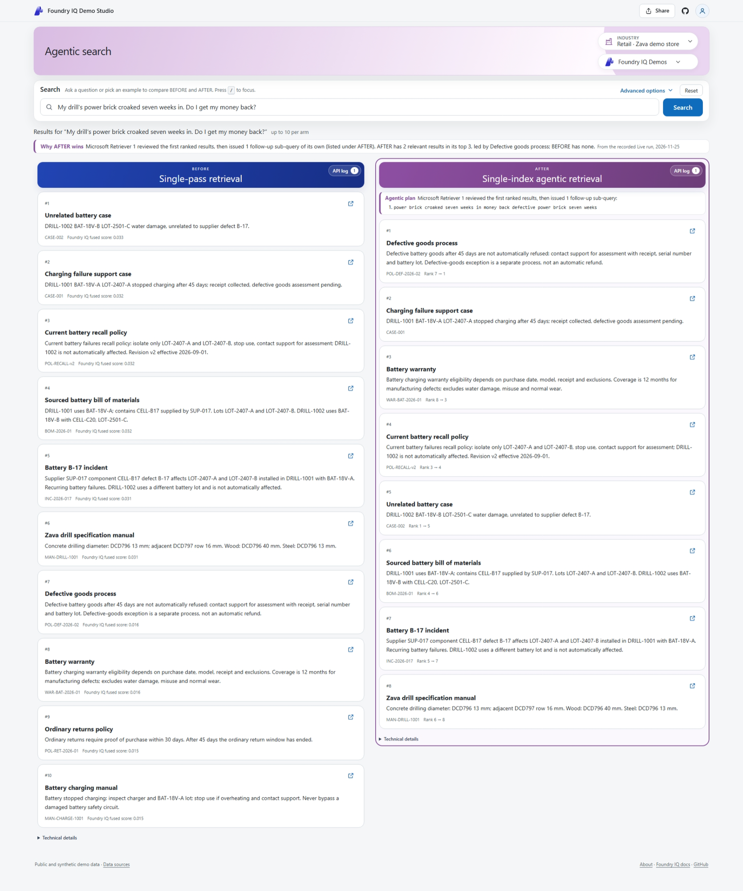

# Foundry IQ Playground

Explore the power of knowledge retrieval with Microsoft Foundry IQ. Compare retrieval strategies side by side, experiment with real-world and synthetic datasets, and see how different retrieval techniques impact relevance, quality, and performance.

[**Launch the playground →**](https://foundry-iq-demo-studio.vercel.app)

## What you can explore

| Retrieval mode | What it demonstrates |
| --- | --- |
| Keyword search | Full-text term matching with BM25, analyzers and synonyms |
| Vector search | Semantic similarity and conceptual matching |
| Hybrid search | Combining keyword and vector retrieval |
| Semantic ranking | Improved relevance through reranking |
| Filtered search with facets | Hybrid retrieval within store, stock, price or metadata filters |
| Scoring profiles | Business-driven relevance and boosting |
| Agentic retrieval | Query planning with model-issued follow-up searches |
| Graph-enhanced retrieval | Relationship-aware knowledge discovery |
| Topic-based retrieval | Discovery across themes and topics |
| Document layout extraction | Retrieving exact table rows from complex PDFs |
| Multimodal retrieval | Finding items from an image or a description |

## Datasets & languages

| Datasets | Languages |
| --- | --- |
| Retail · Zava demo store — synthetic products, support articles and a product manual | English, French, Spanish, Japanese, German |
| Retail · Product recalls — U.S. Consumer Product Safety Commission recall notices | English |
| Financial services — OCC and FDIC examination guidance, CFPB complaint narratives | English |
| Healthcare & life sciences — FDA drug labels, ICD-10-CM coding guidelines | English |
| Manufacturing — OSHA injury reports and standards, NIST operational technology guidance | English |
| Energy & utilities — DOE grid incident reports, FERC orders, EIA analysis | English |

Multimodal retrieval is available on the Zava demo store only. In French, Spanish, Japanese and German, the Zava graph scenarios use the English graph. Sources and licenses are listed under [Data sources](https://foundry-iq-demo-studio.vercel.app/about#data-sources).

The planned, not-yet-enabled fashion demo credits [Fashion Product Images (Small)](https://www.kaggle.com/datasets/paramaggarwal/fashion-product-images-small), uploaded by Param Aggarwal. See the [dataset rights note](docs/OPERATIONS.md#product-image-industries-s11-and-the-fashion-product-images-dataset).

## Getting started

1. Select a dataset and retrieval scenario.
2. Choose a sample query or enter your own.
3. Compare results side by side.
4. Explore retrieval quality, citations, and performance.

No setup required for the hosted experience. To run it locally, see [docs/OPERATIONS.md](docs/OPERATIONS.md).

## Resources

- [Foundry IQ documentation](https://learn.microsoft.com/azure/foundry/agents/concepts/what-is-foundry-iq)
- [Report an issue or suggest a scenario](https://github.com/farzad528/foundry-iq-demo/issues)

## License

[MIT](./LICENSE). Microsoft product artwork and embedded fonts keep their own terms; see [assets/PROVENANCE.md](assets/PROVENANCE.md).
