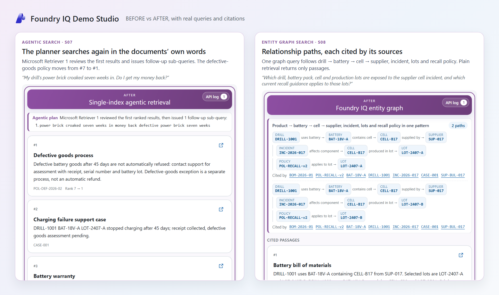

# Foundry IQ Demo Studio

**Foundry IQ (Azure AI Search)** is the knowledge and retrieval layer for agents and apps built with Microsoft Foundry.
This demo runs one question through two retrieval setups, **BEFORE** and **AFTER**, and shows the cited results side by side.

**Live demo:** <https://foundry-iq-demo-studio.vercel.app/>



## Contents

- [Demonstrated scenarios](#demonstrated-scenarios)
- [Industries & supported languages](#industries--supported-languages)
- [Search examples](#search-examples)
- [Run locally](#run-locally)
- [Learn more](#learn-more)

## Demonstrated scenarios

| Scenario | BEFORE | AFTER | Why it matters |
| --- | --- | --- | --- |
| S01 Keyword search | Exact substring match | Full-text search with analyzers and synonyms | Finds content worded differently from the query |
| S02 Vector search | Keyword search | Text-vector similarity | Matches meaning when no words overlap |
| S03 Hybrid search | Keyword search, same filters | Keyword + vector (hybrid), same filters | Keeps exact terms and adds meaning |
| S04 Semantic reranking | Hybrid order | Semantic ranker order, same candidates | Puts the passage that answers the question first |
| S05 Retail search | Keyword search, same filters | Hybrid search with filters and facets | Relevant results within store, stock and price limits |
| S06 Document boosting | Hybrid search | Hybrid search plus a scoring-profile boost | Favors fresh, nearby or authoritative documents |
| S07 Agentic search | Single-pass hybrid retrieval | Agentic retrieval that plans its own searches | Answers multi-part questions in one call |
| S08 Entity graph search | Plain retrieval | Entity-graph paths, each cited by its sources | Follows relationships no single document holds |
| S09 Topic graph search | Topic diversification off | Topic diversification on, plus corpus themes | Covers every theme and sizes the whole collection |
| S10 PDF layout extraction | Read: page text | Layout: table rows with cell coordinates | Cites the exact table row, not a flattened page |
| S11 Multimodal image search | Keyword search over metadata | Image-embedding similarity | Finds items from a picture or a description |

## Industries & supported languages

| Industry | Data | Languages | Scenarios |
| --- | --- | --- | --- |
| Retail · Zava demo store (default) | Synthetic products, support articles and a product manual | en, fr, es, ja, de | S01–S11 |
| Retail · Product recalls (CPSC) | Consumer Product Safety Commission recall notices | en | S01–S09 |
| Financial services | OCC and FDIC examination guidance, interagency guidance, CFPB complaint narratives | en | S01–S10 |
| Healthcare & life sciences | FDA prescription drug labels and ICD-10-CM coding guidelines | en | S01–S10 |
| Manufacturing | OSHA injury reports and standards, NIST operational technology guidance | en | S01–S10 |
| Energy & utilities | DOE grid incident reports, FERC orders and reports, EIA analysis | en | S01–S10 |

S11 (images) is Zava only. In French, Spanish, Japanese and German, Zava S08/S09 use the English Zava graph.
Sources and licenses are listed on the [About page](https://foundry-iq-demo-studio.vercel.app/about#data-sources).

## Search examples

Open a link, then pick the query from the search box's example list. **Sample** replays the recorded Live result; **Live data** queries Foundry IQ.

| Scenario | Industry | Example query | Why AFTER wins | Try it |
| --- | --- | --- | --- | --- |
| S01 | Healthcare & life sciences | `AFib DOAC dose when CrCl 15 to 50` | Synonyms expand AFib and CrCl; plain keyword finds nothing. | [Open](https://foundry-iq-demo-studio.vercel.app/?industry=healthcare&scenario=S01) |
| S02 | Energy & utilities | `utility cut the power on purpose so the lines would not start a fire` | Vector search finds the PG&E wildfire shutoffs; keyword finds nothing relevant. | [Open](https://foundry-iq-demo-studio.vercel.app/?industry=energy&scenario=S02) |
| S03 | Manufacturing | `SP 800-82 Rev. 3 guidance for vendors who need to log in from offsite to fix our controllers` | Hybrid ranks Remote Access guidance #1; keyword's top 10 has none. | [Open](https://foundry-iq-demo-studio.vercel.app/?industry=manufacturing&scenario=S03) |
| S04 | Retail · Product recalls (CPSC) | `Which space heater could switch on by itself without anyone touching it?` | Reranker lifts the self-starting Atomi heater from #4 to #1. | [Open](https://foundry-iq-demo-studio.vercel.app/?industry=retail&scenario=S04) |
| S05 | Retail · Zava demo store | `light driller for stone available in London under £200` | Same filters: hybrid ranks Mason Lite #1; keyword finds nothing. | [Open](https://foundry-iq-demo-studio.vercel.app/?scenario=S05) |
| S06 | Financial services | `funds transfer system risks examiners should review for wire transfers` | Freshness boost replaces a superseded 1990 booklet with 2026 FDIC guidance. | [Open](https://foundry-iq-demo-studio.vercel.app/?industry=financial&scenario=S06) |
| S07 | Retail · Zava demo store | `My drill's power brick croaked seven weeks in. Do I get my money back?` | Plans its own sub-query and finds the defective-goods process BEFORE misses. | [Open](https://foundry-iq-demo-studio.vercel.app/?scenario=S07) |
| S08 | Manufacturing | `Which industries reported severe injuries involving industrial robots from 2015 through 2023?` | One graph query returns all 18 cited reports; search returns 5. | [Open](https://foundry-iq-demo-studio.vercel.app/?industry=manufacturing&scenario=S08) |
| S09 | Retail · Zava demo store | `What should a new Zava store associate know?` | Topic balancing covers 4 of 4 themes; BEFORE covers 2. | [Open](https://foundry-iq-demo-studio.vercel.app/?scenario=S09) |
| S10 | Healthcare & life sciences | `Upper GI bleeding rate with SAVAYSA versus warfarin` | Layout cites the exact Table 6.2 row; Read returns flattened pages. | [Open](https://foundry-iq-demo-studio.vercel.app/?industry=healthcare&scenario=S10) |
| S11 | Retail · Zava demo store | `headwear for a sunny day` | Text-to-image finds the blue hat; metadata keyword finds nothing. | [Open](https://foundry-iq-demo-studio.vercel.app/?scenario=S11) |

## Run locally

Requires Node.js 26 (see `.nvmrc`). No Azure resources or keys are needed.

```bash
npm ci
npm run dev
```

Open <http://localhost:3000>. This public build replays the recorded Zava results in all five languages, with Live off.
Industries, Live data, environment variables, Azure resources, limits, rollback and key revocation are covered in [docs/OPERATIONS.md](docs/OPERATIONS.md).

## Learn more

- [What is Foundry IQ?](https://learn.microsoft.com/azure/foundry/agents/concepts/what-is-foundry-iq)
- [Foundry IQ documentation](https://learn.microsoft.com/azure/search/search-what-is-azure-search)
- [Foundry IQ plugin for agent clients](https://learn.microsoft.com/azure/developer/azure-skills/plugins/foundry-iq/foundry-iq)

[MIT](LICENSE) license. The Microsoft product artwork has separate terms; see [assets/PROVENANCE.md](assets/PROVENANCE.md).
